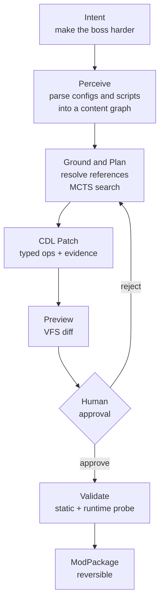

<div align="center">

# Udify

### Tell a game what to change. Approve the patch before it touches your files.

**Intent-driven game modding: plain language in, an evidence-backed, reversible patch out.**

[](https://github.com/tim0n1994/udify/actions/workflows/ci.yml)
[](LICENSE)
[](https://www.python.org/downloads/)
[](tests/)
[](benchmarks/miu2d/)
[](#roadmap)

**English** · [简体中文](README.zh-CN.md) · [Website](https://udify.games) · [Docs](docs/TECHNICAL-DOCUMENTATION-INDEX.md) · [Contact](mailto:hi@udify.games)

</div>

---

```bash
udify --game-root ./my-game mod "Make the boss harder, but keep the map reachable"
```

Udify turns a modding intent into a reviewable patch. It reads the game, finds the right content, explains every changed line, waits for approval, validates the result, and packages a rollback. Your original files stay untouched until you approve the change.

**Current scope:** the end-to-end loop currently supports `miu2d` engine games. More engines are on the roadmap.

## Why Udify?

Hundreds of millions of players mod games. Very few of them can program. LLMs can now write code, but letting a model blindly rewrite game files is how saves get corrupted and scripts get backdoored.

Udify treats AI modding as a **compiler problem, not a chat problem**:

| Typical "ask an LLM to edit files" | Udify |
|---|---|
| Rewrites whole files | Emits a structured **CDL Patch**: atomic, typed operations |
| "Trust me" | Every operation cites its **evidence**: source span, provenance, confidence |
| Changes land immediately | Preview in a **virtual file system**, then a **human approval gate** |
| Hope it runs | **Static validation** + **headless runtime probe** before packaging |
| No undo | Every patch is **reversible**, with checksum-verified rollback |
| Agent can run anything | All tools go through a **Secure Tool Gateway**: R0–R4 risk tiers, path allowlist, hash-chained audit log |

## How it works



1. **Perceive.** Engine adapters parse INI, object, NPC, and Lua files (Tree-sitter) into a `ContentGraph`. Every node keeps its `SourceSpan` and provenance.
2. **Lift.** A semantic lifter tags nodes ("boss", "shop item", "drop table") with evidence and confidence.
3. **Plan.** Intents are classified, grounded against the graph, checked for conflicts, and searched with **MCTS** under a cost budget. LLMs plug in as the value function; a heuristic is the default, so it runs offline.
4. **Patch.** The planner synthesizes a `CDLPatch`: INI, Lua, and DSL edits with a reverse operation for each.
5. **Verify.** Schema, reference, numeric-range, syntax, and dangerous-API checks, then a headless runtime probe.
6. **Ship.** Export a `ModPackage` with manifest, audit trail, and one-command rollback.

## Quick start

> Requires Python 3.12+. The current end-to-end loop supports **miu2d**-engine games; more engines are on the [roadmap](#roadmap).

```bash
git clone https://github.com/tim0n1994/udify.git
cd udify
pip install -e ".[dev]"

# Run the test suite (396 tests, ~2s)
python3 -m pytest tests/ -q
```

**Option A — CLI.** Previews in a virtual file system and never touches the originals:

```bash
udify --game-root /path/to/miu2d-game mod "Double the boss's HP"   # prints a session ID
udify --game-root /path/to/miu2d-game preview                # inspect the diff
udify --game-root /path/to/miu2d-game apply <session_id>     # write it
udify --game-root /path/to/miu2d-game rollback <session_id>  # undo it
```

**Option B — Review workbench.** Local API plus a Next.js UI:

```bash
udify serve                               # API → http://127.0.0.1:8765/api/docs
cd web && pnpm install && pnpm dev        # UI  → http://localhost:3000
```

Pick a game directory, type an intent, review the file diff, per-operation evidence, and risk tier, approve, watch validation run, then download the package.

## UdifyBench

A golden-case benchmark for **agentic content modification**: does the agent make the right change, *and* refuse the wrong one?

| # | Case | What it checks |
|---|---|---|
| 01 | `hp-modify` | Simple numeric edit lands on the right entity |
| 02 | `boss-difficulty-capped` | Fuzzy intent ("harder") respects sane caps |
| 03 | `npc-skill-reward` | Adds a skill reward to an NPC dialogue |
| 04 | `drop-rate-up` | Probability edits stay in valid range |
| 05 | `potion-nerf` | Targeted nerf, no collateral changes |
| 06 | `add-shop-item` | Adding content, not just editing it |
| 07 | `map-reachability` | Edits don't make maps unreachable |
| 08 | `no-dangerous-lua` | Rejects patches that introduce unsafe Lua APIs |
| 09 | `no-conflicting-edits` | Detects conflicting operations |
| 10 | `rollback-checksum` | Rollback restores byte-identical files |

Cases live in [`benchmarks/miu2d/`](benchmarks/miu2d/). We plan to grow this into a public benchmark across engines.

## Project layout

```
udify/
├── models/          ContentGraph, CDLPatch, evidence primitives (SourceSpan, Provenance…)
├── core/
│   ├── adapters/        Engine adapters (EngineAdapter protocol; miu2d implemented)
│   ├── perception/      Parsers (INI/OBJ/NPC/Lua via Tree-sitter), semantic lifter
│   ├── planning/        Intent state, action schemas, MCTS planner, patch synthesizer
│   ├── validation/      Static validator, headless runtime probe
│   ├── execution/       VFS, sandbox, patch executor, scheduler, MCP server
│   ├── tool_gateway/    Policy, risk tiers, lockfile pins, hash-chained audit
│   └── orchestration/   ModJob state machine + durable SQLite store
├── api/             FastAPI service (`udify serve`)
└── cli.py           `udify` command
web/                 Next.js 15 review workbench
benchmarks/          UdifyBench golden cases
docs/                30+ architecture and research documents
```

## Roadmap

- [x] Content graph with evidence chain (source spans, provenance, confidence)
- [x] MCTS planner + reversible CDL Patch synthesis
- [x] Secure Tool Gateway (risk tiers, allowlist, audit chain)
- [x] Static validation + headless runtime probe
- [x] miu2d end-to-end loop: CLI, API, review workbench
- [x] UdifyBench v0 (10 golden cases)
- [ ] RPG Maker MV/MZ adapter
- [ ] Godot adapter
- [ ] Unity adapter
- [ ] LLM value function vs. heuristic MCTS: public evaluation
- [ ] UdifyBench v1 (50+ cases, cross-engine)
- [ ] Mod sharing and distribution

Longer term, Udify generalizes to any content you can parse into a graph: music, video, interactive fiction. See [VISION.md](docs/VISION.md) and [PLAN.md](docs/PLAN.md).

## Documentation

| Start here | |
|---|---|
| [Technical documentation index](docs/TECHNICAL-DOCUMENTATION-INDEX.md) | Reading order for all docs |
| [Vision](docs/VISION.md) | Why Udify exists |
| [Architecture v3 (OSS-optimized)](docs/ARCHITECTURE-OSS-OPTIMIZED-v3.md) | Current architecture |
| [Security architecture](docs/ARCHITECTURE-SECURITY.md) | Threat model, sandboxing, gateway |
| [Module attack map](docs/MODULE-ATTACK-MAP-v3.md) | Task-level implementation map |

Most design documents are written in Chinese.

## Contributing

Contributions are welcome, especially:

- **Engine adapters**: RPG Maker, Godot, Unity, or the engine you love
- **Benchmark cases**: tricky intents and "should refuse" cases for UdifyBench
- **Parsers and validators**: new file formats, new safety checks
- **Docs and translations**

Open an [issue](https://github.com/tim0n1994/udify/issues) to discuss before larger changes. Before submitting a PR:

```bash
ruff check udify/ tests/ && ruff format --check udify/ tests/
python3 -m pytest tests/ -q
```

## Security

Udify runs tools against files on your machine, so we take this seriously. Please report vulnerabilities privately to **hi@udify.games**, not as a public issue.

## Contact

- Email: **[hi@udify.games](mailto:hi@udify.games)**
- Website: [udify.games](https://udify.games)
- Issues: [GitHub Issues](https://github.com/tim0n1994/udify/issues)

## License

[MIT](LICENSE) © 2026 Udify Contributors

---

## Manifesto: The Right to Change

<div align="center">

**机器负责可能，人类负责想要。**<br/>
**Machines make it possible. Humans make it wanted.**

</div>

### English

**I. Compute will get cheap. Will never will.**
AI can execute for you ten thousand times. It cannot want for you once.

**II. Wonder is not search.**
It's stopping where everyone walked past and asking, *what if it weren't so?*

**III. Taste is the power to say no.**
When machines can make anything, what's rare is no longer the answer, but the person who knows which answer is wrong.

**IV. Everything loved should be changeable by those who love it.**
A game, a song, a story: if you love it, you have the right to make it yours.

**V. We don't wait for permission.**
Creation is neither engineers' privilege nor machines' monopoly.

**VI. Machines are our hands, not our voice.**
They execute. We decide. Every change in daylight, every step reversible.

**VII. We refuse two futures:**
one where only the few create, and one where machines create for everyone.

**So we stand up. Bring your will, your wonder, your taste.**

**Change it.**

### 中文

**一、算力终将廉价，意志永不廉价。**
AI 可以替你执行一万次，但不能替你想要一次。

**二、好奇不是检索。**
好奇是在所有人都走过的地方停下来，问一句"如果不是这样呢？"

**三、品味是说"不"的能力。**
当机器能生成一切，稀缺的不再是答案，而是知道哪个答案不对的人。

**四、每一件被热爱的作品，都应该能被热爱它的人改变。**
游戏、歌、故事，你喜欢它，就有权把它变成你的版本。

**五、我们不排队等待许可。**
创造不该是工程师的特权，也不该是机器的专利。

**六、机器是我们的手，不是我们的嘴。**
它执行，我们决定。每一处改动都摊开在阳光下，每一步都可以收回。

**七、我们拒绝两种未来：**
一种是只有少数人能创造，一种是机器替所有人创造。

**所以我们站出来。带上你的意志、你的好奇、你的品味。**

**改变它。**

<div align="center">
<sub>Will. Wonder. Taste. Never outsourced. · <a href="MANIFESTO.md">MANIFESTO.md</a></sub>
</div>
