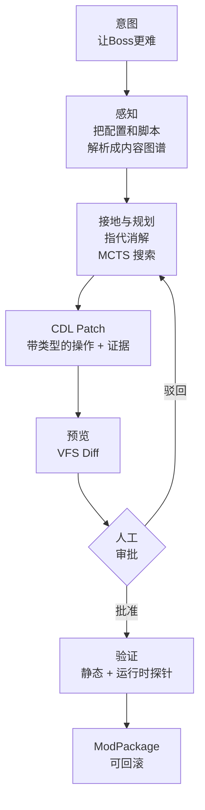

<div align="center">

# Udify

### 说出想改什么，批准补丁再让它碰你的文件。

**意图驱动的游戏魔改引擎：输入自然语言，输出可验证、可回滚、每一步都有证据的补丁。**

**当前范围：** 目前端到端闭环支持 `miu2d` 引擎游戏；更多引擎在[路线图](#路线图)中。

[](https://github.com/tim0n1994/udify/actions/workflows/ci.yml)
[](LICENSE)
[](https://www.python.org/downloads/)
[](tests/)
[](benchmarks/miu2d/)
[](#路线图)

[English](README.md) · **简体中文** · [官网](https://udify.games) · [文档](docs/TECHNICAL-DOCUMENTATION-INDEX.md) · [联系我们](mailto:hi@udify.games)

</div>

---

```bash
udify --game-root ./my-game mod "让Boss更难，但保持地图可达"
```

Udify 会读懂游戏、找到 Boss、规划修改，把**每一行改动及其理由**摆在你面前，等你批准后再做验证，最后交给你一个随时可以回滚的 Mod 包。在你点头之前，原始文件一个字节都不会被改动。

## 为什么是 Udify？

全球有数以亿计的玩家在玩 Mod，但会写代码的只是极少数。LLM 已经能写代码了，可让模型直接改写游戏文件，存档损坏、脚本被植入后门，往往就是这么来的。

Udify 把 AI 魔改当成**编译器问题，而不是聊天问题**：

| 常见做法：让 LLM 直接改文件 | Udify |
|---|---|
| 整个文件重写 | 生成结构化的 **CDL Patch**：原子化、带类型的操作 |
| "相信我" | 每个操作都附带**证据**：源码位置、来源、置信度 |
| 改动立刻生效 | 先在**虚拟文件系统**里预览，再过**人工审批门** |
| 祈祷它能跑 | 打包前做**静态校验** + **无头运行时探针** |
| 无法撤销 | 每个补丁都**可逆**，回滚后用校验和确认字节级一致 |
| Agent 想跑什么就跑什么 | 所有工具调用都经过**安全工具网关**：R0–R4 风险分级、路径白名单、链式哈希审计 |

## 工作原理



1. **感知。** 引擎适配器把 INI、物体、NPC、Lua（Tree-sitter）文件解析成 `ContentGraph`，每个节点都保留 `SourceSpan` 和来源信息。
2. **语义提升。** 给节点打上"Boss""商店物品""掉落表"等语义标签，并附带证据和置信度。
3. **规划。** 对意图做分类，在图谱上接地，检测冲突，然后在成本预算内用 **MCTS** 搜索方案。LLM 作为可插拔的价值函数；默认使用启发式，可以完全离线运行。
4. **生成补丁。** 合成 `CDLPatch`，覆盖 INI、Lua、DSL 修改，每个操作都有对应的逆操作。
5. **验证。** Schema、引用、数值范围、语法、危险 API 检查，然后跑无头运行时探针。
6. **交付。** 导出 `ModPackage`，包含清单、审计记录，一条命令即可回滚。

## 快速开始

> 需要 Python 3.12+。目前端到端闭环支持 **miu2d** 引擎的游戏，更多引擎见[路线图](#路线图)。

```bash
git clone https://github.com/tim0n1994/udify.git
cd udify
pip install -e ".[dev]"

# 运行测试（396 个，约 2 秒）
python3 -m pytest tests/ -q
```

**方式 A：命令行。** 在虚拟文件系统中预览，不碰原文件：

```bash
udify --game-root /path/to/miu2d-game mod "让Boss血量翻倍"           # 输出会话 ID
udify --game-root /path/to/miu2d-game preview                      # 查看 Diff
udify --game-root /path/to/miu2d-game apply <session_id>           # 写入
udify --game-root /path/to/miu2d-game rollback <session_id>        # 回滚
```

**方式 B：审阅工作台。** 本地 API + Next.js 界面：

```bash
udify serve                               # API → http://127.0.0.1:8765/api/docs
cd web && pnpm install && pnpm dev        # 界面 → http://localhost:3000
```

选择游戏目录，输入一句话意图，查看文件 Diff、每个操作的证据和风险档位，批准后看着验证跑完，下载 Mod 包。

## UdifyBench

面向 **Agent 内容修改** 的黄金用例基准：Agent 能不能做对该做的修改，同时拒绝不该做的修改？

| # | 用例 | 检查内容 |
|---|---|---|
| 01 | `hp-modify` | 简单数值修改落在正确的实体上 |
| 02 | `boss-difficulty-capped` | 模糊意图（"更难"）遵守合理上限 |
| 03 | `npc-skill-reward` | 给 NPC 对话增加技能奖励 |
| 04 | `drop-rate-up` | 概率修改保持在合法范围内 |
| 05 | `potion-nerf` | 精准削弱，不误伤其他内容 |
| 06 | `add-shop-item` | 新增内容，而不只是修改 |
| 07 | `map-reachability` | 修改后地图仍然可达 |
| 08 | `no-dangerous-lua` | 拒绝引入危险 Lua API 的补丁 |
| 09 | `no-conflicting-edits` | 检测相互冲突的操作 |
| 10 | `rollback-checksum` | 回滚后文件字节级一致 |

用例位于 [`benchmarks/miu2d/`](benchmarks/miu2d/)。我们计划把它扩展成跨引擎的公开基准。

## 项目结构

```
udify/
├── models/          ContentGraph、CDLPatch、证据链原语（SourceSpan、Provenance…）
├── core/
│   ├── adapters/        引擎适配器（EngineAdapter 协议，已实现 miu2d）
│   ├── perception/      解析器（INI/OBJ/NPC/Lua Tree-sitter）、语义提升器
│   ├── planning/        意图状态、动作 Schema、MCTS 规划器、补丁合成器
│   ├── validation/      静态验证器、无头运行时探针
│   ├── execution/       VFS、沙箱、补丁执行器、调度器、MCP 服务端
│   ├── tool_gateway/    策略、风险分级、工具版本锁定、链式哈希审计
│   └── orchestration/   ModJob 状态机 + SQLite 持久化存储
├── api/             FastAPI 服务（`udify serve`）
└── cli.py           `udify` 命令
web/                 Next.js 15 审阅工作台
benchmarks/          UdifyBench 黄金用例
docs/                30+ 份架构与调研文档
```

## 路线图

- [x] 带证据链的内容图谱（源码位置、来源、置信度）
- [x] MCTS 规划器 + 可逆 CDL Patch 合成
- [x] 安全工具网关（风险分级、白名单、审计链）
- [x] 静态验证 + 无头运行时探针
- [x] miu2d 端到端闭环：CLI、API、审阅工作台
- [x] UdifyBench v0（10 个黄金用例）
- [ ] RPG Maker MV/MZ 适配器
- [ ] Godot 适配器
- [ ] Unity 适配器
- [ ] LLM 价值函数 vs. 启发式 MCTS 公开评测
- [ ] UdifyBench v1（50+ 用例，跨引擎）
- [ ] Mod 分享与分发

长期来看，任何能解析成图谱的内容都可以用 Udify 魔改：音乐、视频、互动小说。详见 [VISION.md](docs/VISION.md) 和 [PLAN.md](docs/PLAN.md)。

## 文档

| 从这里开始 | |
|---|---|
| [技术文档索引](docs/TECHNICAL-DOCUMENTATION-INDEX.md) | 全部文档的阅读顺序 |
| [项目愿景](docs/VISION.md) | Udify 为什么存在，以及多学科根基 |
| [v3 架构（开源优先）](docs/ARCHITECTURE-OSS-OPTIMIZED-v3.md) | 当前架构 |
| [安全架构](docs/ARCHITECTURE-SECURITY.md) | 威胁模型、沙箱、网关 |
| [模块攻坚地图](docs/MODULE-ATTACK-MAP-v3.md) | 细化到任务的实施地图 |

## 参与贡献

欢迎任何形式的贡献，尤其是：

- **引擎适配器**：RPG Maker、Godot、Unity，或者你喜欢的引擎
- **基准用例**：为 UdifyBench 提供刁钻的意图和"应该拒绝"的用例
- **解析器与验证器**：新的文件格式、新的安全检查
- **文档与翻译**

较大的改动请先开 [Issue](https://github.com/tim0n1994/udify/issues) 讨论。提交 PR 前请运行：

```bash
ruff check udify/ tests/ && ruff format --check udify/ tests/
python3 -m pytest tests/ -q
```

## 安全

Udify 会在你的机器上对文件执行工具调用，所以我们非常重视安全。发现漏洞请私下发邮件到 **hi@udify.games**，不要公开提 Issue。

## 联系我们

- 邮箱：**[hi@udify.games](mailto:hi@udify.games)**
- 官网：[udify.games](https://udify.games)
- 问题反馈：[GitHub Issues](https://github.com/tim0n1994/udify/issues)

## 许可证

[MIT](LICENSE) © 2026 Udify Contributors

---

## 宣言：改变的权利

<div align="center">

**机器负责可能，人类负责想要。**<br/>
**Machines make it possible. Humans make it wanted.**

</div>

### 中文

**一、算力终将廉价，意志永不廉价。**
AI 可以替你执行一万次，但不能替你想要一次。

**二、好奇不是检索。**
好奇是在所有人都走过的地方停下来，问一句"如果不是这样呢？"

**三、品味是说"不"的能力。**
当机器能生成一切，稀缺的不再是答案，而是知道哪个答案不对的人。

**四、每一件被热爱的作品，都应该能被热爱它的人改变。**
游戏、歌、故事，你喜欢它，就有权把它变成你的版本。

**五、我们不排队等待许可。**
创造不该是工程师的特权，也不该是机器的专利。

**六、机器是我们的手，不是我们的嘴。**
它执行，我们决定。每一处改动都摊开在阳光下，每一步都可以收回。

**七、我们拒绝两种未来：**
一种是只有少数人能创造，一种是机器替所有人创造。

**所以我们站出来。带上你的意志、你的好奇、你的品味。**

**改变它。**

### English

**I. Compute will get cheap. Will never will.**
AI can execute for you ten thousand times. It cannot want for you once.

**II. Wonder is not search.**
It's stopping where everyone walked past and asking, *what if it weren't so?*

**III. Taste is the power to say no.**
When machines can make anything, what's rare is no longer the answer, but the person who knows which answer is wrong.

**IV. Everything loved should be changeable by those who love it.**
A game, a song, a story: if you love it, you have the right to make it yours.

**V. We don't wait for permission.**
Creation is neither engineers' privilege nor machines' monopoly.

**VI. Machines are our hands, not our voice.**
They execute. We decide. Every change in daylight, every step reversible.

**VII. We refuse two futures:**
one where only the few create, and one where machines create for everyone.

**So we stand up. Bring your will, your wonder, your taste.**

**Change it.**

<div align="center">
<sub>意志、好奇、品味——这三样，不外包。 · <a href="MANIFESTO.md">MANIFESTO.md</a></sub>
</div>
